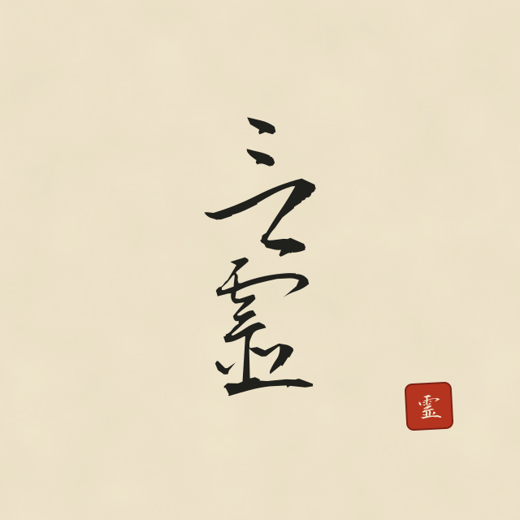

# Anki Enrich

<p align="center">
  
</p>

A personal CLI that keeps a single Anki collection consistent. It pulls the
latest collection from AnkiWeb, runs a set of enrichment passes, and pushes back
without opening the Anki desktop app.

Each pass only touches cards still missing the relevant field, so re-running is
safe. See [`PRD.md`](PRD.md) for the full behavior spec.

## Enrichment passes

- **Term audio** — fill where missing; prefer NHK → Shinmeikai → Forvo → Jpod
  (sourced from the `local-audio-yomichan` add-on).
- **Pitch graphs** — generate accent graphs where missing.
- **Sentence** — add JRP markup (Sudachi tokenization + アクセント辞典v2 accents).
- **Definitions** — a J-J definition (三省堂 → 広辞苑 → 実用 → 大辞泉) plus JMdict
  J-E glosses below it.
- **Examples** — an expandable 例文 block (≤3, deduped) from
  Jitendex/Saito/Yourei + the Tatoeba dump.
- **Cloze** — set the cloze fields.

A separate `dedupe` pass merges duplicate cards while preserving review history.

## Setup

Requires Python ≥ 3.11 and [`uv`](https://docs.astral.sh/uv/).

```sh
# required — AnkiWeb sync
export ANKIWEB_USERNAME=...
export ANKIWEB_PASSWORD=...

# optional — Telegram run reports (`--notify`) and the `anki-enrich-bot` listener
export TELEGRAM_BOT_TOKEN=...
export TELEGRAM_CHAT_ID=...      # your own chat id; the bot ignores everyone else
```

| Variable | Required | Purpose |
| --- | --- | --- |
| `ANKIWEB_USERNAME` / `ANKIWEB_PASSWORD` | yes | AnkiWeb login for pull/push |
| `TELEGRAM_BOT_TOKEN` / `TELEGRAM_CHAT_ID` | for `--notify` / the bot | where run reports go and which chat may drive the bot |
| `ANKI_ADDONS_DIR` | no | build-time only: where `audio/build.py` looks for the `local-audio-yomichan` add-on when building `var/audio.sqlite` (default `~/.local/share/Anki2/addons21`). Unused at runtime/deploy. |

The tool keeps its own collection at `var/collection.anki2` (never the desktop
profile). On first run it builds `var/defs.sqlite` from `dicts/` and, if the J→E
dicts and Tatoeba dump are present, `var/examples.sqlite`. The accent index ships
in `ankienrich/data/`.

Optional sources, skipped (not failed) when absent:

- `local-audio-yomichan` add-on → term audio
- J→E dicts in `dicts/` + Tatoeba dump → example sentences

## Usage

```sh
uv run anki-enrich              # pull latest, dry-run preview (no writes)
uv run anki-enrich --apply      # back up, write in place, push to AnkiWeb
uv run anki-enrich --apply --notify   # also send the result to Telegram
uv run anki-enrich dedupe --apply     # destructive duplicate merge
uv run anki-enrich-bot          # listener: /run triggers a run (apply + report)
```

Every run is a **dry-run by default**: it prints what each pass would change and
how many cards it would touch. `--apply` backs up the collection first, then
writes and syncs.

## Development

```sh
uv run pytest
```

A proof-of-concept lives in `poc/` as a read-only reference — nothing is linked
or compiled against it.
